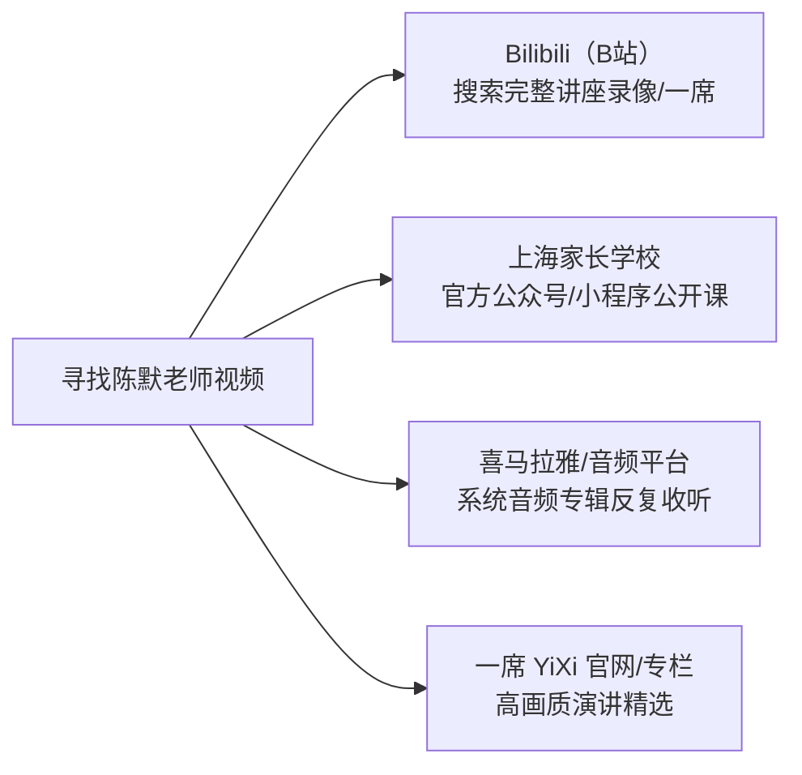

# 陈默老师家庭教育视频与讲座全索引学习指南

> **专家简介**：陈默老师，知名儿童及青少年心理教育专家，华东师范大学心理健康教育与咨询中心特聘心理咨询师、督导，上海心理学会基础教育专业委员会秘书长。拥有数万例真实儿童青少年个案咨询经验，其演讲风格以**一针见血、幽默犀利、直击当代中国家庭痛点、极具实操指导性**而广受数百万家长赞誉。

---

## 目录导览

1. [必看镇楼篇：底层认知与破局](#一必看镇楼篇底层认知与破局)
2. [学龄阶段篇：小学习惯与中学青春期](#二学龄阶段篇小学习惯与中学青春期)
3. [痛点攻坚篇：厌学、手机与亲子对抗](#三痛点攻坚篇厌学手机与亲子对抗)
4. [实战案例篇：华东师大心理咨询室经典个案](#四实战案例篇华东师大心理咨询室经典个案)
5. [全网权威观看平台与检索直达清单](#五全网权威观看平台与检索直达清单)
6. [配套拓展书单与视频对照](#六配套拓展书单与视频对照)

---

## 一、必看镇楼篇：底层认知与破局

在观看具体技巧之前，陈默老师建议所有家长先建立对“当代孩子”与“现代家庭生态”的底层认知，解开自身的焦虑死结。

### 1. 《一席：孩子，你怎么了？》
> 又名：《我们说知识改变命运，现在的孩子会问为什么要改变命运？》

* **讲座时长**：约 31 分钟完整版
* **主讲平台**：【一席少年】教育论坛 / 一席 YiXi
* **推荐指数**：⭐⭐⭐⭐⭐（陈默老师全网播放量破千万的封神之作）
* **核心内容深度剖析**：
  * **当代（00后/10后）孩子的四大心理特征**：
    1. **情感负担极重（高关爱下的压迫感）**：以前一家几个孩子，爱和关注是分散的；现在的孩子独享全家（父母、祖辈）所有目光，这种“沉甸甸的爱”让孩子喘不过气。
    2. **对话语权的高度敏感**：现在的孩子从小通过互联网看世界，拥有前所未有的平等意识，不接受封建家长式的“命令与威权”。
    3. **深度的精神孤独感**：放学回家关进钢筋混凝土的单元楼，缺乏同龄人社群玩耍与自由社交。
    4. **高竞争时代的内驱力迷茫**：前几代人读书是为了“解决温饱改变命运”，而现在的孩子生来不缺物质，大人若再用“出人头地”诱导，孩子会反问：“我现在过得挺好，为什么要吃这种苦去改变命运？”
* **核心金句**：
  > “现在的孩子什么都不缺，为什么眼里没有光了？”  
  > “成人要懂儿童。大人总是用自己的生存经验去要求今天的孩子，这是很多悲剧的根源。”
* **观看路径**：Bilibili 搜索 `【一席少年】陈默：我们说知识改变命运` 或 `陈默 一席 孩子你怎么了`。

---

### 2. 《如何做不焦虑的父母》

* **讲座时长**：约 60~90 分钟（系列公开讲座精编）
* **主讲平台**：上海家长学校 / 华东师大幸福工作室 / 各地教育局名家大讲堂
* **推荐指数**：⭐⭐⭐⭐⭐
* **核心内容深度剖析**：
  * **焦虑的传播链条**：家长的焦虑是成长的隐形诅咒。家长焦虑越重，孩子在学业与社交中表现出的心理退缩与防御机制就越严重。
  * **家庭系统核心定律——夫妻关系高于亲子关系**：
    * 很多家庭的根源问题在于妈妈把全副身心绑在孩子身上，把丈夫推到了边缘。
    * 陈默老师指出：夫妻关系稳定、彼此有爱，是给孩子最好的心理安全垫；家庭关系排序乱了，孩子必然承受不该有的情绪负荷。
  * **“不当大老虎，只做小白兔”**：
    * 家长在家里要学会卸下社会职场的强硬面具，以松弛、温和、接纳的态度面对家人。
* **观看路径**：Bilibili / 微信视频号搜索 `陈默 如何做不焦虑的父母` 或 `陈默 华东师范大学 讲座`。

---

## 二、学龄阶段篇：小学习惯与中学青春期

陈默老师强调：不同年龄阶段的孩子，心理任务完全不同。小学管习惯，中学管放手。

### 1. 小学阶段（6 ~ 12 岁）：告别陪读鸡飞狗跳，筑牢习惯基石

* **重点讲座推荐**：
  * **《家有小学生：怎样做小学生的家长》**
  * **《孩子写作业拖拉、磨蹭背后的心理机制》**
  * **《别把家变成第二考场：父母的陪伴边界》**
* **核心解法指引**：
  * **为什么陪写作业会爆发“家庭内战”？**  
    家长把“检查作业、纠正错题”当成了监工行为，剥夺了孩子的责任感。孩子潜意识会认为“作业是替父母写的”。
  * **责任归还实操**：
    1. 不催不盯：约定好作业完成时限，到点收笔；哪怕没写完，允许他去学校承担被老师批评的自然结果。
    2. 关注身心节律：小学低年级孩子专注力有限，每学25~30分钟需要活动肢体，而不是强求一动不动。
    3. 重在习惯与自信：不要为了小学一两道错题把亲子关系弄僵，保护孩子对求知的积极态度胜过考满分。

---

### 2. 中学与青春期阶段（12 ~ 18 岁）：破译青春期密码

* **重点讲座推荐**：
  * **《家有中学生：当孩子关上房门，父母该怎么沟通？》**
  * **《青春期逆反与心理断乳期干预指南》**
  * **《家有中考生、高考生：家长如何助力不添乱》**
* **核心解法指引**：
  * **读懂青春期的“身心海啸”**：
    * 激素剧增、第二性征发育、自我意识爆棚。孩子顶嘴、烦躁、反锁房门，并不是“变坏”，而是他在本能地尝试与父母进行“心理断乳”，建立自我边界。
  * **角色的彻底转变：从“行政长官”变成“后勤保障与啦啦队”**：
    * 千万不要和青春期孩子硬碰硬讲大道理。陈默老师直言：“在青春期和孩子争辩输赢的家长，最后往往输掉了孩子的人生。”
  * **迎战中高考的“定海神针”法则**：
    * **生活保持平常感**：越是大考当前，家里越要保持平常节奏，不要刻意大补营养、全家轻手轻脚，那是在给孩子无形加压。
    * **闭上唠叨的嘴，端水放下就走**：多关注日常起居和饭菜口味，不拿模考成绩作为每天谈话的唯一话题。
    * **支持性语言替代打击性废话**：当孩子沮丧时，接纳情绪（“这次暴露问题总比大考好，爸妈一直在你身后”），而非火上浇油（“早跟你说了不听，活该考砸”）。

---

## 三、痛点攻坚篇：厌学、手机与亲子对抗

针对当前中国家庭最常见的三大“心病”，陈默老师提供了系统的心理咨询视角应对方案。

### 1. 孩子厌学、拒绝上学与动力丧失
* **核心讲座**：《解密厌学情绪：原发性学习障碍与继发性心理危机》
* **关键诊断**：
  * 孩子不是突然厌学的，厌学往往是长期的自尊心受挫、高期待压垮与人际孤立后的“心理防御性罢工”。
  * 先治心，再治学。孩子厌学时，强行送去补课无异于雪上加霜；家长首先要做的是“降低期待、情绪松绑”，重建孩子的自我效能感。

### 2. 沉迷手机、网络游戏与虚拟社交
* **核心讲座**：《数字时代的挑战：手机背后的心理诉求与家庭数字公约》
* **关键诊断**：
  * **看清背后的真相**：现实世界里如果充满挑剔、批评和挫败，虚拟世界里有成就感、即时奖励和同伴认同，孩子必然倒向手机。
  * **拒绝粗暴抢摔手机**：极端收缴手机极易引发激烈的亲子冲突甚至极端事件。
  * **制定温和而坚定的《数字公约》**：父母以身作则放下手机，与孩子平权协商每日游戏时间与规则，用现实中有温度的户外运动和同伴交往替代虚拟补偿。

### 3. 亲子关系剑拔弩张与冷暴力破冰
* **核心心法**：**修习父母的“钝感力”**。
  * 面对孩子的冲撞或冷漠，不要立刻升温回击。等情绪退潮后，以“无条件关注”重新破冰，给彼此留出心理缓冲区。

---

## 四、实战案例篇：华东师大心理咨询室经典个案

在哔哩哔哩等平台上，有华东师范大学心理健康教育与咨询中心公开的系列咨询案例剖析，陈默老师亲自担任咨询师还原心理干预全过程：

| 经典案例名称 | 涉及问题与群体 | 咨询焦点与核心启示 |
| :--- | :--- | :--- |
| **《父女冤家》** | 中学女生与严苛父亲 | 父亲将控制欲伪装成关爱，女儿用叛逆甚至自残反抗；解法在于父亲学会真正放手与道歉。 |
| **《母子战争》** | 焦虑母亲与厌学儿子 | 窒息式母爱导致的亲子内耗；通过重塑母亲个人生活，解除对儿子的心理共生绑定。 |
| **《偷内衣的少年》** | 青春期行为偏差与性心理 | 青少年性心理启蒙缺失与潜意识焦虑发泄；去病理化对待，科学引导性心理疏导。 |
| **《夜半敲门声》** | 考前极度焦虑与躯体化障碍 | 学业重压转化为躯体症状（失眠、惊恐）；系统脱敏与家庭降压干预。 |

---

## 五、全网权威观看平台与检索直达清单

为了避免看到低劣的AI营销号搬运剪辑，建议通过以下官方或优质渠道观看高清完整讲座：

### 1. 哔哩哔哩（Bilibili）
* **优势**：完整版讲座多、弹幕互动强、画质清晰，许多高校/官方录制视频在此收录。
* **推荐精准搜索词**：
  * `【一席少年】陈默：我们说知识改变命运`
  * `陈默 心理讲座 完整版`
  * `陈默 华东师范大学 讲座`
  * `陈默 上海家长学校`

### 2. 上海家长学校（微信公众号 / 微信小程序）
* **优势**：上海官方权威主办的家庭教育品牌，陈默老师为核心特聘专家，收录大量高清官方名家大讲堂公开课。
* **获取方式**：在微信搜索关注“上海家长学校”，进入“在线课堂/视频回放”专区检索“陈默”。

### 3. 一席（YiXi）官方平台
* **优势**：电影级摄影、深度演讲文稿配套。
* **代表作**：一席第527期《孩子，你怎么了？》。

### 4. 喜马拉雅（音频系统课）
* **优势**：适合家长在通勤、做家务时反复磨耳朵。
* **经典专辑**：
  * 《陈默：如何做不焦虑的家长》
  * 《告别吼叫，做高效家长》

---

## 六、配套拓展书单与视频对照

陈默老师的讲座多脱胎于其撰写的经典专著，搭配书籍阅读效果翻倍：

| 专著名称 | 对应视频主题 | 适读人群 | 核心解决问题 |
| :--- | :--- | :--- | :--- |
| **《孩子，你怎么了》** | 《一席：孩子你怎么了》《个案分析》 | 全学龄段家长、心理老师 | 剖析当代儿童青少年的心理困境、抑郁、行为偏差诊断 |
| **《家有小学生》** | 《小学生习惯养成与陪读困境》 | 幼小衔接、小学1-6年级家长 | 作业磨蹭拖拉、好习惯养成、生活自理、责任感建立 |
| **《家有中学生》** | 《青春期密码》《中高考陪伴指南》 | 初中生、高中生家长 | 青春期反叛、关闭心门沟通、恋爱萌芽、中高考学业心理调节 |

---

> [!TIP]
> **家长学习建议**：建议先花 30 分钟看《一席：孩子，你怎么了？》建立通识同理心；再根据孩子目前的学龄（小学或中学）选择对应的专题讲座；遇到情绪崩溃时，反复听听《如何做不焦虑的父母》给自己注入情绪定力。
